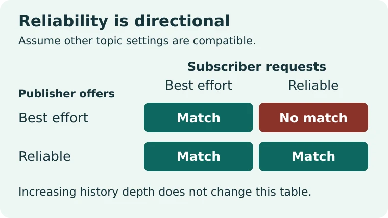
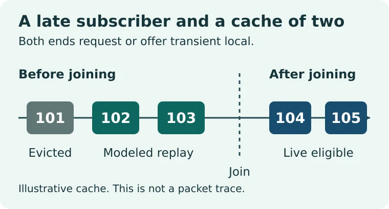

# ROS 2 QoS compatibility lab

Find why a synthetic camera topic can appear in a ROS 2 graph but still deliver no messages to one subscriber. Then predict which saved status samples a late subscriber could see. This exercise compares two explicit QoS policies in offline Python. It does not run ROS 2, use a real camera or measure a network.

The complete [ROS 2 QoS lesson](https://wifarobotics.com/learn/ros-2-qos-settings/) explains each case and how to investigate a real topic.

## Start from zero

1. Install a maintained [Python 3 release](https://www.python.org/downloads/) (3.11 or later). On Windows you can use `py -3` wherever the commands below use `python3`.
2. On GitHub, select **Code → Download ZIP** and extract it. If Git is installed instead, run `git clone https://github.com/williamfarokhzad/wifa-ros-2-qos-settings.git`.
3. Open a terminal in the extracted or cloned folder containing `qos_lab.py`. Run `python3 --version`. There is nothing to install with pip.

```sh
python3 qos_lab.py examples/camera-mismatch.json
python3 qos_lab.py examples/camera-compatible.json
python3 qos_lab.py examples/status-late-join.json
python3 qos_lab.py examples/status-volatile-reader.json
python3 -m unittest discover -s tests -v
```

| Example | Compatible within the model? | Reason | Replay IDs | Eligible live IDs |
| --- | --- | --- | --- | --- |
| camera-mismatch | No | reliability | none | none |
| camera-compatible | Yes | none | none | 104, 105 |
| status-late-join | Yes | none | 102, 103 | 104, 105 |
| status-volatile-reader | Yes | none | none | 104, 105 |

`python3 qos_lab.py examples/invalid-depth.json` should exit with code 2 and report that the publisher depth must be a positive integer. A valid but incompatible case exits 0 and returns a diagnosis in JSON.

## Change one variable

Copy `status-late-join.json` to a new name. Change only the publisher's `depth` from 2 to 1. Predict the result, then run the copy: the replay list should contain only ID 103. Change only the publisher's `durability` to `volatile` and keep the subscriber's request at `transient_local`. The result should now list a durability mismatch and no eligible IDs.

The `before_join` and `after_join` lists use increasing positive integer identifiers. They do not represent milliseconds. The publisher's `depth` is a sample count for an idealized keep last cache.





## Troubleshooting and limits

- File not found: run from the folder with `qos_lab.py`, and check the filename and extension.
- Invalid scenario: use quoted policy names from the examples. Do not copy `SYSTEM_DEFAULT` directly from a ROS 2 report. Resolve the actual settings first.
- Compatible but quiet in a real ROS graph: check whether the publisher is sending, then check the topic, type, domain, discovery and other QoS settings. On a configured Jazzy shell, `ros2 topic info /your_topic --verbose` inspects endpoints without publishing.
- The program models one publisher and one subscriber. It omits DDS transport, discovery, timing, retry behavior, resource limits, additional policies and subscriber queues. A live eligible ID does not imply delivery. No hardware or live ROS 2 middleware was tested.

Figures are editable SVGs. To regenerate WebPs, install Node.js and `npm install --no-save sharp` in a disposable copy, then run `node diagrams/render.mjs`. Node and Sharp are only for figure export.

Reference: [Open Robotics' Jazzy QoS guide source](https://raw.githubusercontent.com/ros2/ros2_documentation/jazzy/source/Concepts/Intermediate/About-Quality-of-Service-Settings.rst) and [topic inspection tutorial source](https://raw.githubusercontent.com/ros2/ros2_documentation/jazzy/source/Tutorials/Beginner-CLI-Tools/Understanding-ROS2-Topics/Understanding-ROS2-Topics.rst).
